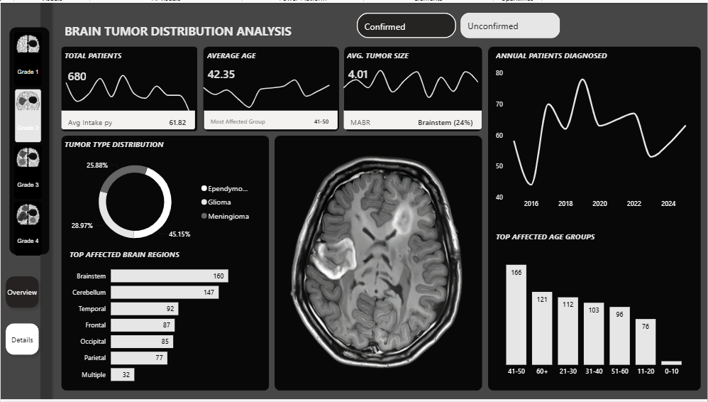
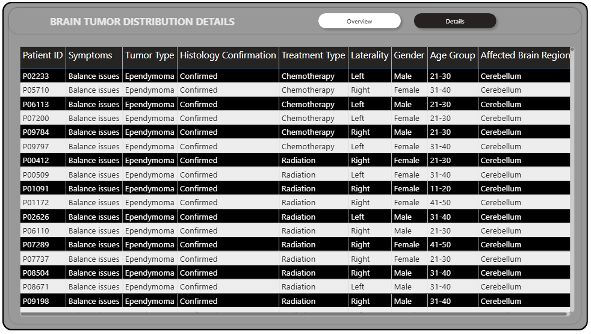

# Brain Tumor Distribution Analysis

## Project overview
This project analyses a brain-tumor dataset to summarize diagnosed patients, histology confirmation status, the most affected brain region for each tumor type, and treatment patterns by tumor type. The attached dashboard screenshots provide a visual reference for the analysis.

> **Data note:** The analysis below was calculated from the supplied CSV file, which contains **10,000 patient records**. The overview screenshot displays a total of 680 patients, so its figures do not match the full CSV totals. This may reflect a dashboard filter, a different extract, or an earlier version of the data. Confirm the dashboard filters and data source before presenting the figures together.

## 1. Total diagnosed patients and confirmation status

- **Total diagnosed patients/records:** 10,000
- **Histology confirmed:** 7,473 (**74.73%**)
- **Histology unconfirmed:** 2,527 (**25.27%**)

Confirmation status is taken from the `Histology Confirmation` column. “Unconfirmed” means histology confirmation is not recorded as confirmed in this dataset; it should not automatically be interpreted as absence of a tumor.

## 2. Most affected brain region by tumor type

| Tumor type | Total records | Most represented affected region | Records in region | Share of that tumor type |
|---|---:|---|---:|---:|
| Ependymoma | 961 | Cerebellum | 489 | 50.9% |
| Glioma | 4,058 | Occipital | 1,048 | 25.8% |
| Medulloblastoma | 1,001 | Cerebellum | 1,001 | 100.0% |
| Meningioma | 3,055 | Temporal | 631 | 20.7% |
| Pituitary Tumor | 925 | Pituitary | 925 | 100.0% |

**Interpretation:** Glioma is the most common tumor type in the dataset (4,058 records). The most represented region varies by tumor type: the cerebellum leads for ependymoma and medulloblastoma, the occipital region leads for glioma, the temporal region leads for meningioma, and the pituitary region is recorded for all pituitary tumor cases. These are patterns in this dataset, not clinical conclusions about where a tumor type usually occurs.

## 3. Treatment type for each tumor type

Counts and percentages below are calculated within each tumor type.

| Tumor type | Surgery | Radiation | Chemotherapy | Observation |
|---|---:|---:|---:|---:|
| Ependymoma (n=961) | 586 (61.0%) | 280 (29.1%) | 95 (9.9%) | 0 (0.0%) |
| Glioma (n=4,058) | 2,107 (51.9%) | 1,165 (28.7%) | 682 (16.8%) | 104 (2.6%) |
| Medulloblastoma (n=1,001) | 484 (48.4%) | 301 (30.1%) | 216 (21.6%) | 0 (0.0%) |
| Meningioma (n=3,055) | 2,150 (70.4%) | 85 (2.8%) | 0 (0.0%) | 820 (26.8%) |
| Pituitary Tumor (n=925) | 636 (68.8%) | 0 (0.0%) | 0 (0.0%) | 289 (31.2%) |

**Key observations:**
- **Surgery** is the most frequently recorded treatment for every tumor type.
- Ependymoma: surgery is most common (61.0%), followed by radiation (29.1%).
- Glioma: surgery is most common (51.9%), with radiation (28.7%) and chemotherapy (16.8%) also recorded.
- Medulloblastoma: surgery is most common (48.4%), followed by radiation (30.1%) and chemotherapy (21.6%).
- Meningioma: surgery accounts for 70.4%; observation accounts for 26.8%.
- Pituitary tumor: surgery accounts for 68.8%, while observation accounts for 31.2%.

These figures describe treatment labels in the supplied dataset. They are not treatment recommendations; actual care depends on individual clinical circumstances and specialist assessment.

## 4. Overall findings

1. The CSV contains **10,000 patient records**.
2. **74.73%** are marked histology-confirmed and **25.27%** unconfirmed.
3. **Glioma** is the largest tumor-type group, representing 4,058 records (40.58% of the dataset).
4. The leading recorded region differs by tumor type, as summarized in the table above.
5. **Surgery** is the most frequently recorded treatment across all five tumor types.

## Dashboard screenshots

The images below are included in this repository folder. Keep the image files alongside this `README.md` so they render correctly on GitHub.

### Overview dashboard

### Details dashboard

## Data and methodology
- **Input:** `Brain Tumor Data(1).csv` (10,000 rows, 12 columns).
- **Fields used:** `Patient ID`, `Tumor Type`, `Affected Brain Region`, `Histology Confirmation`, and `Treatment Type`.
- **Counting method:** patient records were counted by category; unique patient IDs = 10,000 and no missing values were found in the supplied CSV.
- **Percentages:** confirmation percentages use all 10,000 records as the denominator; region and treatment percentages use the relevant tumor-type total as the denominator.
- **Scope:** descriptive analysis only. No causal inference or clinical effectiveness assessment was performed.
